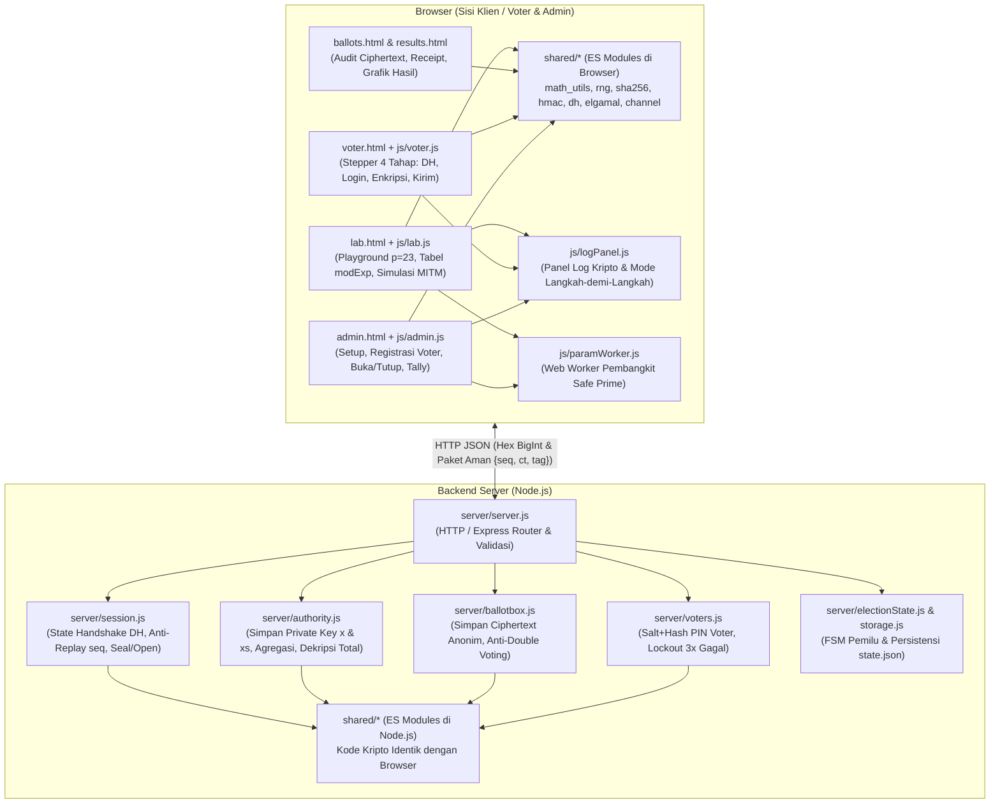

# Implementation Plan: Sistem E-Voting Berbasis Web (Diffie-Hellman & ElGamal Murni Tanpa Library Kriptografi)

Dokumen ini menerjemahkan seluruh spesifikasi pada [plan.md](file:///c:/Kuliah/Sem5/Kripto/DiffieHellman_ElGamal/plan.md) menjadi rencana implementasi teknis yang siap dieksekusi per berkas, lengkap dengan diagram arsitektur, antarmuka modul, potongan kode inti, rumus matematika, desain API/UI, serta skenario pengujian otomatis dan manual.

---

## Goal Description

Membangun aplikasi web **E-Voting ("Pemilihan Ketua BEM Fakultas")** *end-to-end* yang mendemonstrasikan fungsi **setiap tahapan algoritma Diffie-Hellman (DH) dan ElGamal** dalam satu studi kasus terpadu **tanpa menggunakan library/framework kriptografi**:

1. **Setup Parameter & Keygen Election Authority (EA)**: Pembangkitan bilangan prima aman $p = 2q + 1$, pencari generator $g$ berorde $q$, dan pembangkitan pasangan kunci ElGamal $(x, h = g^x \bmod p)$ serta kunci tanda tangan server $(x_s, y_s = g^{x_s} \bmod p)$.
2. **Saluran Aman Voter–Server (Diffie-Hellman)**: Pertukaran kunci DH ($A = g^a \bmod p$, $B = g^b \bmod p$) dengan autentikasi tanda tangan ElGamal untuk menghasilkan *shared secret* $K = g^{ab} \bmod p$, dilanjutkan penurunan kunci sesi (`encKey`, `macKey`) via SHA-256 buatan sendiri untuk mengamankan paket login dan pengiriman suara (*Counter-mode Keystream XOR + Encrypt-then-MAC HMAC-SHA256*).
3. **Enkripsi Suara & Penghitungan Homomorfik (Exponential ElGamal)**: Enkripsi pilihan kandidat langsung di browser sebagai vektor $m_i = g^{v_i} \bmod p$ dengan $v_i \in \{0, 1\}$, penyimpanan anonim di Ballot Box dengan pencegahan *double voting* atomik, agregasi homomorfik $\left(\prod c_{1}, \prod c_{2}\right) \bmod p$, dekripsi hanya pada total suara oleh EA, dan pemulihan jumlah suara $T_j$ melalui logaritma diskret rentang kecil.
4. **Transparansi Edukasi & Pembuktian**: Panel Log Kripto interaktif di setiap halaman yang menampilkan rumus dan nilai variabel antara ($a, A, b, B, K, k, c_1, c_2, C_1, C_2, s, g^T, T$), inspektor paket jaringan, serta halaman **Lab/Playground** dengan *test vector* standar ($p=23, q=11, g=4$) dan simulator serangan MITM.

### Diagram Arsitektur & Alur Protokol



```mermaid
sequenceDiagram
    autonumber
    participant EA as Admin / EA (admin.html)
    participant V as Voter (voter.html)
    participant S as Server (session.js / voters.js)
    participant BB as Ballot Box (ballotbox.js)

    Note over EA,S: Fase A & B: Setup & Registrasi (SETUP -> REGISTRATION -> VOTING)
    EA->>S: POST /api/admin/setup (mode: demo/mid/real)
    S->>S: genSafePrime(bits) -> (p, q), findGenerator(p, q) -> g
    S->>S: elgamalKeygen -> (x, h=g^x mod p), signKeygen -> (xs, ys=g^xs mod p)
    S-->>EA: {p, q, g, h, ys, log[]} (x & xs tetap di server)
    EA->>S: POST /api/admin/voters (daftar V001..V005 + PIN)
    EA->>S: POST /api/admin/open (State -> VOTING)

    Note over V,S: Fase C: Handshake Diffie-Hellman Terautentikasi
    V->>V: Pilih a in [2, q-1], hitung A = g^a mod p
    V->>S: POST /api/handshake/init {voterId, A}
    S->>S: Validasi isInSubgroup(A, p, q)
    S->>S: Pilih b in [2, q-1], hitung B = g^b mod p, K = A^b mod p
    S->>S: Turunkan encKey, macKey = KDF(K, sessionId, A, B)
    S->>S: [BONUS] sig = ElGamalSign(xs, SHA256(sessionId || A || B))
    S-->>V: {sessionId, B, sig}
    V->>V: Validasi isInSubgroup(B) & ElGamalVerify(ys, sig)
    V->>V: Hitung K = B^a mod p, turunkan encKey, macKey
    V->>S: POST /api/handshake/confirm {sessionId, seq:1, ct: Enc("READY|id"), tag}
    S->>S: Verifikasi HMAC tag & dekripsi konfirmasi
    S-->>V: Paket Aman {seq:1, dir:2, ct: Enc("OK"), tag}

    Note over V,S: Fase D: Login Voter di Dalam Saluran DH
    V->>S: POST /api/login Paket Aman {seq:2, ct: Enc({voterId, pin}), tag}
    S->>S: Buka paket, cek SHA256(salt || pin) == pinHash
    S-->>V: Paket Aman {seq:2, ct: Enc({ok:true, candidates, publicKey}), tag}

    Note over V,BB: Fase E: Enkripsi Suara ElGamal & Pengiriman Ballot
    V->>V: Untuk tiap kandidat i=1..N: v_i in {0,1}, m_i = g^(v_i) mod p
    V->>V: Pilih nonce k_i in [2, q-1], c1_i = g^(k_i) mod p, c2_i = m_i * h^(k_i) mod p
    V->>V: Hitung receipt = SHA256(canonicalJson(ballot))
    V->>S: POST /api/vote Paket Aman {seq:3, ct: Enc({ballot}), tag}
    S->>BB: Validasi isInSubgroup(c1_i, c2_i), cek !hasVoted(voterId)
    BB->>BB: Tandai hasVoted=true (atomik), simpan {receipt, cts, castAt} TANPA voterId
    S-->>V: Paket Aman {seq:3, ct: Enc({ok:true, receipt}), tag}

    Note over EA,BB: Fase F: Penutupan & Tally Homomorfik (CLOSED -> TALLIED)
    EA->>S: POST /api/admin/close (State -> CLOSED)
    EA->>S: POST /api/admin/tally (State -> TALLIED)
    S->>BB: Ambil seluruh ciphertext ballot (V suara)
    S->>S: Tiap kandidat j: C1_j = prod(c1) mod p, C2_j = prod(c2) mod p
    S->>S: Dekripsi total: s_j = C1_j^x mod p, gT_j = C2_j * s_j^(-1) mod p
    S->>S: Cari T_j in [0..V] di mana g^(T_j) mod p == gT_j; cek sum(T_j) == V
    S-->>EA: {perCandidate: [{name, C1, C2, gT, T, iterations}], V, consistent}
```

---

## User Review Required

> [!IMPORTANT]
> **Kepatuhan Mutlak Ketentuan "Tanpa Library Kriptografi" (T2 & T6)**
> 1. **Seluruh Primitif Kriptografi Ditulis Sendiri di `shared/`**:
>    - Eksponensiasi modular (`modExp` *square-and-multiply*), Extended Euclidean (`egcd`), invers modular (`modInv`), uji primalitas Miller-Rabin (`isProbablePrime`), pembangkitan *safe prime* (`genSafePrime`), dan pencari generator subgrup (`findGenerator`).
>    - Fungsi hash **SHA-256** (`sha256.js`) dan **HMAC-SHA256** (`hmac.js`) ditulis 100% dari nol sesuai spesifikasi standar FIPS 180-4 & RFC 2104, tanpa memanggil `node:crypto` atau `crypto.subtle`.
>    - Algoritma **Diffie-Hellman** (`dh.js`), **Exponential ElGamal + ElGamal Signature** (`elgamal.js`), dan **Saluran Terenkripsi** (`channel.js`) ditulis 100% dari nol.
> 2. **Sumber Bit Acak Ganda (`shared/rng.js`)**:
>    - Secara default memakai sumber entropi OS (`crypto.getRandomValues`) hanya untuk mengambil bit acak mentah, lalu fungsi `randomBelow` dan `randomRange` ditulis sendiri dengan *rejection sampling*.
>    - Dilengkapi juga dengan mode **Pure Custom PRNG (`Sha256CtrDrbg`)** berbasis SHA-256 buatan sendiri yang dapat diaktifkan lewat `config.js` atau sakelar UI jika dosen melarang penggunaan `getRandomValues` sekalipun.
> 3. **Pemeriksa Kepatuhan Otomatis (`npm run check-banned`)**:
>    - Menyertakan skrip `scripts/check-banned.js` yang memindai seluruh berkas di `shared/` dan menggagalkan *build/test* apabila ditemukan pemanggilan `Math.random`, operator `**` untuk eksponen `BigInt`, `crypto.createDiffieHellman`, `crypto.subtle`, `modPow`, atau library eksternal.

---

## Open Questions

> [!WARNING]
> **Keputusan Desain yang Dapat Disesuaikan Sebelum Eksekusi Kode**
> Rencana ini sudah menyertakan desain lengkap termasuk fitur `[BONUS]`. Sebelum saya mulai mengeksekusi penulisan kode (Fase 1–7), mohon konfirmasi apakah Anda setuju dengan pilihan default berikut:
> 1. **Cakupan Fitur `[BONUS]`**: Rencana ini menyertakan implementasi **(a) Tanda Tangan Digital ElGamal untuk Autentikasi Handshake DH + Simulator Serangan MITM**, **(b) Mode Langkah-demi-Langkah di Panel Log**, serta **(c) Bukti Zero-Knowledge (Disjunctive Chaum-Pedersen ZKP opsional)** yang dapat diaktifkan/dinonaktifkan via sakelar di halaman Admin. Apakah semua fitur bonus ini ingin langsung diikutsertakan?
> 2. **Server HTTP (`express` vs `node:http` murni)**: Sesuai [plan.md](file:///c:/Kuliah/Sem5/Kripto/DiffieHellman_ElGamal/plan.md), backend menggunakan `express` untuk routing HTTP dan penyajian berkas statis. Apakah tetap menggunakan `express`, atau Anda ingin tanpa dependensi npm sama sekali (`node:http` bawaan)?

---

## Proposed Changes

Seluruh berkas akan dibuat di dalam direktori kerja `c:\Kuliah\Sem5\Kripto\DiffieHellman_ElGamal\`. Komponen diurutkan berdasarkan lapisan dependensi (mulai dari konfigurasi dasar, inti matematika/kriptografi `shared/`, backend `server/`, frontend `public/`, hingga pengujian `test/`).

### 1. Konfigurasi Proyek & Skrip Pemeriksa Kepatuhan

 Menyiapkan konfigurasi ES Modules (`"type": "module"`), pengaturan default pemilu, dan pemindai otomatis kata kunci terlarang.

#### [NEW] [package.json](file:///c:/Kuliah/Sem5/Kripto/DiffieHellman_ElGamal/package.json)
- Mengatur `"type": "module"`.
- Menyediakan skrip:
  - `"start": "node server/server.js"`
  - `"test": "node --test test/*.test.js"`
  - `"check-banned": "node scripts/check-banned.js"`
- Dependensi hanya `express` (untuk HTTP routing dan static file serving).

#### [NEW] [config.js](file:///c:/Kuliah/Sem5/Kripto/DiffieHellman_ElGamal/config.js)
- Menyimpan konfigurasi terpusat:
  - `PORT`: `3000`
  - `ADMIN_TOKEN`: `"bem-kripto-2026"`
  - `DEFAULT_MODE`: `"demo"` (`32` bit), mendukung `"tiny"` (`24` bit), `"demo"` (`32` bit), `"mid"` (`256` bit), `"real512"` (`512` bit), dan `"real2048"` (`2048` bit RFC 3526 Group 14).
  - `DEFAULT_CANDIDATES`: `["Kandidat 1 - Andi Pratama", "Kandidat 2 - Citra Lestari", "Kandidat 3 - Dimas Wibowo"]`
  - `DEFAULT_VOTERS`: 5 pemilih terdaftar (`V001` s.d. `V005`) beserta PIN demo default untuk kemudahan skenario presentasi Bagian 14.2.
  - `SESSION_TTL_MS`: `10 * 60 * 1000` (10 menit).
  - `MAX_LOGIN_ATTEMPTS`: `3`.

#### [NEW] [scripts/check-banned.js](file:///c:/Kuliah/Sem5/Kripto/DiffieHellman_ElGamal/scripts/check-banned.js)
- Memindai semua berkas `.js` di dalam `shared/`.
- Menolak keberadaan token terlarang: `Math.random`, `createDiffieHellman`, `createECDH`, `createCipher`, `createSign`, `subtle`, `modPow`, `bigint-crypto-utils`, `node-forge`, serta operator `**` pada perhitungan modular.

---

### 2. Lapisan Kriptografi & Matematika Bersama (`shared/`)

Folder `shared/` berisi ES Modules murni tanpa dependensi eksternal yang diimpor baik oleh Node.js (`server/`) maupun oleh browser (`public/js/`).

#### [NEW] [shared/encoding.js](file:///c:/Kuliah/Sem5/Kripto/DiffieHellman_ElGamal/shared/encoding.js)
- Utilitas konversi tipe data yang menjamin kesamaan representasi byte antara browser dan server:
  - `toHex(n: bigint): string` dan `fromHex(hex: string): bigint` (validasi ketat string heksadesimal huruf kecil).
  - `bytesToHex(bytes: Uint8Array): string` dan `hexToBytes(hex: string): Uint8Array`.
  - `bigToBytes(n: bigint, fixedLength?: number): Uint8Array` dan `bytesToBig(bytes: Uint8Array): bigint` (endianness *big-endian* konsisten agar $K$ menghasilkan byte identik di kedua sisi).
  - `utf8ToBytes(str: string): Uint8Array`, `bytesToUtf8(bytes: Uint8Array): string`, `concatBytes(...arrays: Uint8Array[]): Uint8Array`.
  - `canonicalJson(obj: any): string` (mengurutkan key objek secara deterministik untuk perhitungan hash *receipt* ballot).

#### [NEW] [shared/sha256.js](file:///c:/Kuliah/Sem5/Kripto/DiffieHellman_ElGamal/shared/sha256.js)
- Implementasi mandiri algoritma **SHA-256** sesuai FIPS 180-4:
  - Konstanta 64 kata bulat $K[0..63]$ dan nilai hash awal $H^{(0)}[0..7]$.
  - *Pre-processing / padding* bit `1`, diikuti bit `0` hingga kongruen $448 \pmod{512}$, lalu panjang pesan 64-bit *big-endian*.
  - Fungsi kompresi 64 putaran dengan operasi bitwise 32-bit ($\Sigma_0, \Sigma_1, \sigma_0, \sigma_1, \text{Ch}, \text{Maj}$).
  - Mengekspor `sha256(bytes: Uint8Array): Uint8Array` dan `sha256Hex(input: Uint8Array | string): string`.

#### [NEW] [shared/hmac.js](file:///c:/Kuliah/Sem5/Kripto/DiffieHellman_ElGamal/shared/hmac.js)
- Implementasi mandiri **HMAC-SHA256** sesuai RFC 2104:
  - Ukuran blok $B = 64$ byte, $\text{ipad} = \text{0x36}$, $\text{opad} = \text{0x5c}$.
  - Rumus: $\text{HMAC}(K, m) = \text{SHA256}((K' \oplus \text{opad}) \parallel \text{SHA256}((K' \oplus \text{ipad}) \parallel m))$.
  - `constantTimeEqual(a: Uint8Array, b: Uint8Array): boolean`: perbandingan akumulator XOR `diff |= a[i] ^ b[i]` untuk mencegah *timing attack* saat memverifikasi tag MAC.

#### [NEW] [shared/rng.js](file:///c:/Kuliah/Sem5/Kripto/DiffieHellman_ElGamal/shared/rng.js)
- Pembangkit bilangan acak seragam untuk `BigInt`:
  - `setRngMode(mode: 'os' | 'custom_drbg')`: memilih antara CSPRNG sistem operasi (`globalThis.crypto.getRandomValues`) atau **SHA-256 CTR-DRBG** buatan sendiri.
  - `randomBytes(length: number): Uint8Array`
  - `randomBelow(n: bigint): bigint`: membangkitkan bilangan acak sepanjang `bitLength(n)` bit, melakukan *bit-masking* pada byte paling signifikan, dan menerapkan *rejection sampling* ($\text{val} < n$) agar distribusi seragam sempurna tanpa *modulo bias*.
  - `randomRange(lo: bigint, hi: bigint): bigint`: mengembalikan `lo + randomBelow(hi - lo + 1n)`.

#### [NEW] [shared/math_utils.js](file:///c:/Kuliah/Sem5/Kripto/DiffieHellman_ElGamal/shared/math_utils.js)
- Pustaka aritmetika modular dan teori bilangan yang ditulis dari nol:

```js
// Square-and-multiply: menghitung (base^exp) mod m dalam waktu O(log exp)
export function modExp(base, exp, mod, collectSteps = false) {
  if (mod <= 0n) throw new Error('Modulus harus positif');
  if (mod === 1n) return collectSteps ? { result: 0n, steps: [] } : 0n;
  let result = 1n;
  let b = ((base % mod) + mod) % mod;
  let e = exp;
  const steps = [];
  let bitIndex = 0;
  while (e > 0n) {
    const bit = e & 1n;
    const prevResult = result;
    if (bit === 1n) {
      result = (result * b) % mod;
    }
    if (collectSteps) {
      steps.push({ bitIndex, bit: Number(bit), baseBefore: b, prevResult, resultAfter: result });
    }
    e >>= 1n;
    b = (b * b) % mod;
    bitIndex++;
  }
  return collectSteps ? { result, steps } : result;
}

// Extended Euclidean Algorithm (Iteratif) -> { g: gcd(a,b), x, y } sehingga a*x + b*y = g
export function egcd(a, b) {
  let old_r = a, r = b;
  let old_x = 1n, x = 0n;
  let old_y = 0n, y = 1n;
  while (r !== 0n) {
    const q = old_r / r;
    [old_r, r] = [r, old_r - q * r];
    [old_x, x] = [x, old_x - q * x];
    [old_y, y] = [y, old_y - q * y];
  }
  return { g: old_r, x: old_x, y: old_y };
}

// Invers modular: a * a^(-1) === 1 (mod m)
export function modInv(a, m) {
  const normA = ((a % m) + m) % m;
  const { g, x } = egcd(normA, m);
  if (g !== 1n) throw new Error(`Invers modular tidak ada karena gcd(${a}, ${m}) = ${g}`);
  return ((x % m) + m) % m;
}
```

- Fungsi tambahan di `math_utils.js`:
  - `smallPrimeSieve(limit = 2000)`: saringan Eratosthenes untuk mempercepat eliminasi kandidat komposit sebelum Miller-Rabin.
  - `isProbablePrime(n: bigint, rounds = 40): boolean`: dekomposisi $n - 1 = 2^s \cdot d$ dan pengujian saksi Miller-Rabin.
  - `genPrime(bits: number): bigint`: membangkitkan kandidat ganjil dengan MSB dan LSB bernilai `1`, diuji dengan `isProbablePrime`.
  - `genSafePrime(bits: number, onProgress?: Function): { p: bigint, q: bigint, attempts: number }`: mencari prima Sophie Germain $q$ berukuran `bits - 1` bit (uji saringan prima kecil terhadap $q$ dan $2q+1$ sekaligus: jika $q \equiv \frac{r-1}{2} \pmod r$ maka $2q+1$ habis dibagi $r$), lalu memverifikasi $q$ dan $p = 2q + 1$ dengan Miller-Rabin.
  - `findGenerator(p: bigint, q: bigint): bigint`: memilih $h \in [2, p-2]$ acak, menghitung $g = h^2 \bmod p$, dan memastikan $g \neq 1$. Karena orde $\mathbb{Z}_p^*$ adalah $p-1 = 2q$, maka kuadrat dari elemen apa pun yang bukan $\pm 1 \pmod p$ dijamin berorde tepat $q$.
  - `isInSubgroup(y: bigint, p: bigint, q: bigint): boolean`: memverifikasi $1 < y < p - 1$ dan $y^q \bmod p = 1$.
  - `RFC3526_GROUP14_2048`: konstanta prima aman 2048-bit standar beserta fungsi validasi penuh saat dimuat.

#### [NEW] [shared/dh.js](file:///c:/Kuliah/Sem5/Kripto/DiffieHellman_ElGamal/shared/dh.js)
- Implementasi pertukaran kunci Diffie-Hellman di subgrup orde $q$:
  - `dhGenerateKeyPair(params: { p, q, g }, fixedPriv?: bigint): { priv: bigint, pub: bigint, formula: string }`:
    - Memilih kunci privat $a \in [2, q-1]$ (atau `fixedPriv` untuk mode Lab/tes).
    - Menghitung kunci publik $A = g^a \bmod p$.
  - `dhComputeShared(params: { p, q, g }, priv: bigint, otherPub: bigint): { K: bigint, validSubgroup: boolean }`:
    - Memanggil `isInSubgroup(otherPub, p, q)`. Jika gagal, melempar error `"Nilai publik DH tidak berada di dalam subgrup orde q"` (mencegah serangan subgrup kecil).
    - Menghitung $K = \text{otherPub}^{\text{priv}} \bmod p$.

#### [NEW] [shared/elgamal.js](file:///c:/Kuliah/Sem5/Kripto/DiffieHellman_ElGamal/shared/elgamal.js)
- Implementasi lengkap ElGamal (Enkripsi Eksponensial, Agregasi Homomorfik, Dekripsi, Tanda Tangan Digital `[BONUS]`, dan Bukti ZKP Chaum-Pedersen `[BONUS]`):
  - `elgamalKeygen(params, fixedX?)`: menghasilkan $x \in [2, q-1]$ dan $h = g^x \bmod p$.
  - `elgamalEncrypt(params, h, m, fixedK?)`:
    - Validasi `isInSubgroup(m, p, q)` (catatan: $g^0 = 1$ juga anggota sah subgrup orde $q$ karena $1^q \bmod p = 1$, sehingga fungsi `isValidSubgroupElement` mengizinkan $y = 1$ khusus untuk pesan $m$ dan ciphertext, sementara untuk kunci publik DH $A, B$ tetap mensyaratkan $1 < y < p-1$).
    - Memilih nonce unik $k \in [2, q-1]$, menghitung $c_1 = g^k \bmod p$ dan $c_2 = (m \cdot h^k) \bmod p$.
  - `elgamalDecrypt(params, x, { c1, c2 })`:
    - Menghitung $s = c_1^x \bmod p$, $s^{-1} = \text{modInv}(s, p)$, dan $m = (c_2 \cdot s^{-1}) \bmod p$.
  - `elgamalMultiply(params, ctA, ctB)`:
    - Menghitung $C_1 = (c_{1A} \cdot c_{1B}) \bmod p$ dan $C_2 = (c_{2A} \cdot c_{2B}) \bmod p$.
  - `encodeVote(choiceIndex, numCandidates)`: menghasilkan vektor $[v_0, v_1, \dots, v_{N-1}]$ dengan $v_j = 1$ pada `choiceIndex` dan $0$ pada indeks lainnya.
  - `encryptBallot(params, h, choiceIndex, numCandidates, fixedNonces?)`: mengenkripsi $m_i = g^{v_i} \bmod p$ untuk setiap kandidat dengan nonce $k_i$ independen, mengembalikan `{ cts, nonces, mValues, vector }`.
  - `aggregateBallots(params, ballots, numCandidates)`: mengalikan seluruh ciphertext per kandidat $j$ menghasilkan `[{ C1, C2 }]`.
  - `recoverTally(params, gT, maxVotes)`: mencari $T \in [0, \text{maxVotes}]$ sehingga $g^T \bmod p = gT$, mengembalikan `{ T, iterations, steps }`.
  - **`[BONUS]` Tanda Tangan ElGamal (Subgrup Orde $q$)**:
    - `elgamalSignKeygen(params, fixedXs?)`: $x_s \in [2, q-1]$, $y_s = g^{x_s} \bmod p$.
    - `elgamalSign(params, xs, msgBytes, fixedK?)`:
      - $H = \text{bytesToBig}(\text{sha256}(msgBytes)) \bmod q$.
      - Loop hingga $s \neq 0$: pilih $k \in [2, q-1]$, $r = g^k \bmod p$, $s = (k^{-1} \cdot (H - x_s \cdot (r \bmod q))) \bmod q$.
    - `elgamalVerify(params, ys, msgBytes, { r, s })`:
      - Cek $1 < r < p$ (`isInSubgroup(r, p, q)`) dan $1 \le s < q$.
      - Verifikasi $g^H \bmod p \stackrel{?}{=} (y_s^{r \bmod q} \cdot r^s) \bmod p$.
  - **`[BONUS]` Disjunctive Chaum-Pedersen ZKP (Fiat-Shamir)**:
    - `proveBitZkp(params, h, v, c1, c2, k)` dan `verifyBitZkp(params, h, c1, c2, proof)`: membuktikan bahwa $(c_1, c_2)$ mengenkripsi $g^0=1$ atau $g^1=g$ tanpa membocorkan $v$ maupun $k$.
    - `proveSumOneZkp(params, h, cts, nonces)` dan `verifySumOneZkp(params, h, cts, proof)`: membuktikan bahwa hasil kali seluruh komponen dalam satu ballot mengenkripsi tepat $g^1$ ($\sum v_i = 1$).

#### [NEW] [shared/channel.js](file:///c:/Kuliah/Sem5/Kripto/DiffieHellman_ElGamal/shared/channel.js)
- Implementasi saluran aman berbasis kunci sesi DH $K$:
  - `deriveKeys(params, K, sessionId, A, B)`:
    - `Kbytes = bigToBytes(K, Math.ceil(bitLength(params.p) / 8))`
    - `transcript = sha256(utf8ToBytes(`${sessionId}|${toHex(A)}|${toHex(B)}`))`
    - `encKey = sha256(concatBytes(utf8ToBytes("ENC"), Kbytes, transcript))`
    - `macKey = sha256(concatBytes(utf8ToBytes("MAC"), Kbytes, transcript))`
  - `seal(keys, dir, seq, payloadObj)`:
    - Mengubah `payloadObj` menjadi byte UTF-8 JSON.
    - Membangkitkan *keystream* per blok 32-byte: $\text{block}_i = \text{SHA256}(\text{encKey} \parallel \text{dir}(1\text{B}) \parallel \text{seq}(8\text{B}) \parallel i(4\text{B}))$.
    - Melakukan XOR antara plaintext dan *keystream* menghasilkan `ctBytes`.
    - Menghitung `tagBytes = hmacSha256(macKey, concatBytes([dir], seqBytes8, ctBytes))` (*Encrypt-then-MAC*).
    - Mengembalikan `{ seq, ct: bytesToHex(ctBytes), tag: bytesToHex(tagBytes) }`.
  - `open(keys, expectedDir, packet, lastSeq)`:
    - Memastikan `packet.seq > lastSeq` (mencegah *replay attack*).
    - Menghitung ulang HMAC atas `expectedDir || seq || ct` dan membandingkannya dengan `constantTimeEqual` sebelum mendekripsi (*verify-before-decrypt*).
    - Melakukan XOR `ctBytes` dengan *keystream* dan mengembalikan objek JSON hasil parse.

---

### 3. Backend Server & Mesin Pemilu (`server/`)

#### [NEW] [server/logger.js](file:///c:/Kuliah/Sem5/Kripto/DiffieHellman_ElGamal/server/logger.js)
- Mencatat setiap langkah kriptografi sisi server ke dalam *ring buffer* (maksimal 500 entri) dengan struktur:
  `{ id, timestamp, actor: 'SERVER' | 'EA' | 'BALLOT_BOX', algo: 'DH' | 'ELGAMAL' | 'CHANNEL' | 'SYSTEM', step, formula, values, summary }`.
- Menyediakan fungsi `logStep(...)`, `getLogs(sinceId?)`, dan `clearLogs()`.

#### [NEW] [server/electionState.js](file:///c:/Kuliah/Sem5/Kripto/DiffieHellman_ElGamal/server/electionState.js)
- Mengelola *state machine* pemilu dengan transisi ketat:
  `SETUP -> REGISTRATION -> VOTING -> CLOSED -> TALLIED`.
- Menyediakan `getState()`, `canTransition(nextState)`, `transitionTo(nextState)`, `requireState(allowedStates)`, dan `resetState()`.

#### [NEW] [server/authority.js](file:///c:/Kuliah/Sem5/Kripto/DiffieHellman_ElGamal/server/authority.js)
- Mengisolasi rahasia Election Authority (`x` dan `xs`) di dalam *module closure* sehingga modul lain tidak pernah memiliki akses langsung ke variabel `x`:
  - `setupElection({ mode, customBits, candidates, enableZkp })`: membangkitkan parameter $(p, q, g)$, memanggil `elgamalKeygen` dan `elgamalSignKeygen`, mencatat log kripto EA, dan mengembalikan parameter publik `{ mode, bits, p, q, g, h, ys, candidates, enableZkp }`.
  - `signHandshake(sessionId, A, B)`: menandatangani transkrip handshake DH menggunakan $x_s$.
  - `tallyElection(ballots)`: menjalankan agregasi homomorfik $\prod c_1$ dan $\prod c_2$ per kandidat, mendekripsi hanya hasil agregat menggunakan $x$, memulihkan $T_j$ dengan `recoverTally`, dan memverifikasi $\sum T_j = V$. Tidak memiliki fungsi untuk mendekripsi ballot individual.

#### [NEW] [server/voters.js](file:///c:/Kuliah/Sem5/Kripto/DiffieHellman_ElGamal/server/voters.js)
- Mengelola daftar pemilih terdaftar:
  - `registerVoters(voterList)`: membuat `salt` acak 16-byte per voter, menyimpan `pinHash = sha256Hex(salt + "|" + pin)`, `hasVoted: false`, `failedAttempts: 0`, `locked: false`.
  - `verifyVoterPin(voterId, pin)`: mengecek apakah akun terkunci (`failedAttempts >= 3`), membandingkan `pinHash` dengan `constantTimeEqual`, menambah `failedAttempts` jika salah, atau me-reset ke 0 jika benar.
  - `markVoterVoted(voterId)` dan `getVoterPublicList()` (mengembalikan `[{ id, hasVoted, locked }]` tanpa `pinHash` maupun pilihan suara).

#### [NEW] [server/ballotbox.js](file:///c:/Kuliah/Sem5/Kripto/DiffieHellman_ElGamal/server/ballotbox.js)
- Kotak suara publik yang menjamin pencegahan pemilihan ganda dan anonimitas penyimpanan:
  - `castBallot(voterId, ballotPayload, params, publicKey)`:
    1. Memverifikasi struktur vektor ciphertext `cts` sepanjang jumlah kandidat $N$.
    2. Memverifikasi setiap $(c_{1,i}, c_{2,i})$ berada di subgrup orde $q$.
    3. Jika mode ZKP aktif, memverifikasi bukti Chaum-Pedersen tiap kandidat dan bukti jumlah suara $= 1$.
    4. Mengecek dan menandai `voters.markVoterVoted(voterId)` secara atomik (lempar HTTP `409 Conflict` jika sudah memilih).
    5. Menghitung `receipt = sha256Hex(canonicalJson(cts))` dan menyimpan `{ receipt, cts, castAt }` ke array ballot **tanpa menyertakan `voterId`** (serta mengacak urutan tampilan atau menyimpan terpisah dari tabel voter).

#### [NEW] [server/session.js](file:///c:/Kuliah/Sem5/Kripto/DiffieHellman_ElGamal/server/session.js)
- Mengelola sesi Diffie-Hellman antara browser voter dan server:
  - `initHandshake(voterId, A_hex)`:
    - Memastikan state adalah `VOTING`, voter terdaftar & belum memilih, serta $A$ anggota subgrup orde $q$.
    - Membangkitkan $(b, B = g^b \bmod p)$, menghitung $K = A^b \bmod p$, menurunkan `(encKey, macKey)`, membuat `sessionId` acak 16-byte, dan meminta tanda tangan ElGamal `sig` dari `authority.signHandshake`.
    - Menyimpan sesi `{ id, voterId, A, B, K, keys, lastSeqIn: 0, seqOut: 0, confirmed: false, authed: false, createdAt }`.
  - `confirmHandshake(sessionId, packet)`:
    - Membuka paket `seq = 1` (`dir = 1`), memastikan plaintext adalah `"READY|" + sessionId`, menandai `confirmed = true`, dan membalas dengan paket aman `seq = 1` (`dir = 2`) berisi `{ status: "OK", message: "Handshake DH terverifikasi" }`.
  - `openVoterPacket(sessionId, packet, requireAuthed = true)` dan `sealServerPacket(sessionId, payloadObj)`.

#### [NEW] [server/storage.js](file:///c:/Kuliah/Sem5/Kripto/DiffieHellman_ElGamal/server/storage.js)
- Menyimpan dan memuat snapshot publik pemilu ke berkas opsional `state.json` serta menyediakan fungsi `seedDemoReadyState()` agar presenter dapat menyiapkan 5 pemilih terdaftar (`V001`–`V005`) dalam satu klik.

#### [NEW] [server/server.js](file:///c:/Kuliah/Sem5/Kripto/DiffieHellman_ElGamal/server/server.js)
- Server Express yang menyajikan berkas statis (`public/` di `/` dan `shared/` di `/shared`) serta mengimplementasikan seluruh endpoint API pada Bagian 8.3 [plan.md](file:///c:/Kuliah/Sem5/Kripto/DiffieHellman_ElGamal/plan.md):
  - `GET /api/params`: mengambil parameter publik $(p, q, g, h, y_s)$, daftar kandidat, daftar status voter, dan state pemilu.
  - `POST /api/admin/setup`: membangkitkan parameter & keypair EA (`SETUP -> REGISTRATION`).
  - `POST /api/admin/voters`: mendaftarkan voter baru atau memuat preset 5 voter demo.
  - `POST /api/admin/open`: membuka pemungutan suara (`REGISTRATION -> VOTING`).
  - `POST /api/admin/close`: menutup pemungutan suara (`VOTING -> CLOSED`).
  - `POST /api/admin/tally`: menjalankan agregasi homomorfik dan dekripsi total (`CLOSED -> TALLIED`).
  - `POST /api/admin/reset`: mengembalikan state ke awal atau langsung ke preset siap demo.
  - `POST /api/admin/simulate-votes`: (opsional bantu demo Bagian 14.1 menit ke-9) mengenkripsi dan mengirim suara untuk voter sisa (`V002`–`V005`) sesuai skenario naskah demo agar presentasi berjalan cepat.
  - `POST /api/handshake/init` & `POST /api/handshake/confirm`: tahapan handshake Diffie-Hellman.
  - `POST /api/login`: autentikasi PIN voter di dalam paket terenkripsi kunci sesi DH.
  - `POST /api/vote`: pengiriman ballot ElGamal di dalam paket terenkripsi kunci sesi DH.
  - `GET /api/ballots`: daftar receipt dan ciphertext di Ballot Box publik.
  - `GET /api/results`: hasil tally homomorfik dan bukti konsistensi.
  - `GET /api/log`: mengambil log tahapan kripto sisi server untuk ditampilkan di UI.

---

### 4. Aplikasi Web Frontend & Playground Lab (`public/`)

Seluruh halaman menggunakan HTML5 semantik, CSS modern berkonsep *Academic Crypto Dashboard* (kontras tinggi, nyaman untuk proyektor kelas, font monospace untuk nilai variabel kriptografi), dan JavaScript ES Modules murni.

#### [NEW] [public/css/style.css](file:///c:/Kuliah/Sem5/Kripto/DiffieHellman_ElGamal/public/css/style.css)
- Tata letak *split-screen* responsif: kolom kiri/utama untuk interaksi pengguna, kolom kanan *sticky* untuk **Panel Log Kripto** *real-time*.
- Badge warna khusus per algoritma:
  - `DH` (Biru `#2563eb`), `ELGAMAL` (Hijau `#16a34a`), `CHANNEL` (Ungu/Abu `#64748b`), `SERVER/EA` (Oranye `#d97706`), `ATTACK/MITM` (Merah `#dc2626`).

#### [NEW] [public/js/logPanel.js](file:///c:/Kuliah/Sem5/Kripto/DiffieHellman_ElGamal/public/js/logPanel.js)
- Komponen UI terpusat untuk menampilkan setiap tahapan kriptografi sesuai tabel Bagian 5 [plan.md](file:///c:/Kuliah/Sem5/Kripto/DiffieHellman_ElGamal/plan.md):
  - Menampilkan waktu, badge aktor, badge algoritma, judul langkah, blok rumus matematika, dan daftar nilai variabel (`p, q, g, a, A, b, B, K, k, c1, c2, tag`, dll.).
  - Sakelar **"Mode Edukasi (Tampilkan Rahasia)"**: menampilkan/menyembunyikan variabel rahasia ($a, k, K$) di layar.
  - Sakelar **"Tampilkan Angka Penuh"**: memotong angka 256/512/2048-bit dengan `...` secara default atau membukanya penuh.
  - Sakelar **"Mode Langkah demi Langkah"** dengan tombol **"Langkah Berikutnya"** untuk mengontrol kecepatan pemaparan saat presentasi di depan dosen.
  - Tombol **"Salin Log (Markdown/Teks)"** untuk langsung ditempel ke lampiran laporan.

#### [NEW] [public/js/paramWorker.js](file:///c:/Kuliah/Sem5/Kripto/DiffieHellman_ElGamal/public/js/paramWorker.js)
- Web Worker yang mengimpor `shared/math_utils.js` untuk menjalankan `genSafePrime` dan `findGenerator` di *background thread* browser tanpa membuat UI membeku, sambil mengirim progres jumlah kandidat prima yang diuji.

#### [NEW] [public/index.html](file:///c:/Kuliah/Sem5/Kripto/DiffieHellman_ElGamal/public/index.html)
- Halaman utama yang memuat ringkasan arsitektur, indikator *live state* pemilu saat ini, peta 14 tahapan kriptografi (Tabel Bagian 5), serta kartu navigasi ke halaman **Admin/EA**, **Bilik Suara (Voter)**, **Ballot Box Publik**, **Hasil & Audit Tally**, dan **Lab/Playground**.

#### [NEW] [public/admin.html](file:///c:/Kuliah/Sem5/Kripto/DiffieHellman_ElGamal/public/admin.html) & [public/js/admin.js](file:///c:/Kuliah/Sem5/Kripto/DiffieHellman_ElGamal/public/js/admin.js)
- Panel kendali Panitia / Election Authority (EA):
  1. **Setup Parameter & Kunci EA**: pilihan ukuran bit (`24-bit Presentasi`, `32-bit Demo`, `256-bit Menengah`, `512-bit Realistis`, `2048-bit RFC 3526`), opsi aktifkan tanda tangan ElGamal & ZKP, tombol **Generate Parameter & Keypair**. Menampilkan $p, q, g, h, y_s$ dan menyembunyikan $x$ (dengan indikator bahwa $x$ hanya disimpan di memori `authority.js`).
  2. **Manajemen Voter**: tabel voter terdaftar (`V001`–`V005`), tombol **Muat 5 Voter Demo (V001–V005)** dengan tampilan PIN satu kali, serta form tambah voter manual.
  3. **Kendali State Pemilu**: tombol transisi `Buka Pemungutan Suara (VOTING)`, tombol bantu demo `Simulasikan Suara V002–V005 (K1=3, K2=1, K3=1)`, tombol `Tutup Pemungutan Suara (CLOSED)`, tombol `Jalankan Tally Homomorfik (TALLIED)`, dan tombol `Reset Demo`.

#### [NEW] [public/voter.html](file:///c:/Kuliah/Sem5/Kripto/DiffieHellman_ElGamal/public/voter.html) & [public/js/voter.js](file:///c:/Kuliah/Sem5/Kripto/DiffieHellman_ElGamal/public/js/voter.js)
- Bilik suara interaktif dengan **Stepper 4 Langkah** + **Panel Pembuktian & Inspektor Jaringan**:
  - **Langkah 1 – Handshake Diffie-Hellman**: memilih ID Voter (mis. `V001`), membangkitkan $a$ dan $A = g^a \bmod p$ di browser, mengirim ke `/api/handshake/init`, menerima $B$ dan tanda tangan server $(r, s)$, memverifikasi tanda tangan ElGamal server, menghitung $K = B^a \bmod p$, menurunkan `encKey` & `macKey`, serta mengirim paket konfirmasi `/api/handshake/confirm`. Menampilkan badge hijau **"K voter == K server (Terverifikasi HMAC)"**.
  - **Langkah 2 – Login Saluran Aman**: memasukkan PIN voter, mengenkripsi `{ voterId, pin }` dengan `channel.seal` (`seq = 2`), dan mengirim ke `/api/login`.
  - **Langkah 3 – Pilih Kandidat & Enkripsi ElGamal di Browser**: memilih salah satu kandidat, menekan tombol **"Enkripsi Suara (ElGamal Eksponensial)"** untuk melihat pembentukan vektor $v_i \in \{0, 1\}$, $m_i = g^{v_i}$, pemilihan nonce acak $k_i$, dan perhitungan $(c_{1,i}, c_{2,i})$ per kandidat sebelum dikirim.
  - **Langkah 4 – Pengiriman Paket Aman, Bukti Receipt & Uji Serangan**: membungkus ciphertext ballot ke dalam paket aman `channel.seal` (`seq = 3`), menampilkan **Perbandingan 3 Sudut Pandang** (*Apa yang diketahui Voter* vs *Apa yang terlihat di Jaringan / Tab Network* vs *Apa yang diterima Server*), menampilkan kode **Receipt SHA-256**, serta menyediakan tombol demonstrasi keamanan: **"Coba Vote Ulang (Uji Anti-Double Voting)"** dan **"Kirim Ulang Paket Lama (Uji Anti-Replay)"**.

#### [NEW] [public/ballots.html](file:///c:/Kuliah/Sem5/Kripto/DiffieHellman_ElGamal/public/ballots.html) & [public/js/ballots.js](file:///c:/Kuliah/Sem5/Kripto/DiffieHellman_ElGamal/public/js/ballots.js)
- Halaman **Ballot Box Publik**:
  - Pencarian/verifikasi *receipt* milik voter.
  - Tabel seluruh ballot terenkripsi yang masuk (menampilkan nomor urut, waktu, hash *receipt*, dan pasangan $(c_1, c_2)$ tiap kandidat tanpa identitas pengirim).
  - Tabel status partisipasi pemilih (`V001`–`V005`: Sudah Memilih / Belum Memilih) yang terpisah dari isi ballot.

#### [NEW] [public/results.html](file:///c:/Kuliah/Sem5/Kripto/DiffieHellman_ElGamal/public/results.html) & [public/js/results.js](file:///c:/Kuliah/Sem5/Kripto/DiffieHellman_ElGamal/public/js/results.js)
- Halaman **Hasil Pemilu & Verifikasi Homomorfik**:
  - Grafik batang perolehan suara tiap kandidat dan status konsistensi $\sum_{j=1}^N T_j = V$.
  - Rincian matematis per kandidat: nilai perkalian homomorfik $C_{1,j} = \prod c_{1}$ dan $C_{2,j} = \prod c_{2}$, hasil dekripsi total $s_j = C_{1,j}^x \bmod p$ dan $g^{T_j} = C_{2,j} \cdot s_j^{-1} \bmod p$, serta tabel iterasi pencarian logaritma diskret $g^0, g^1, \dots, g^{T_j}$ hingga cocok.

#### [NEW] [public/lab.html](file:///c:/Kuliah/Sem5/Kripto/DiffieHellman_ElGamal/public/lab.html) & [public/js/lab.js](file:///c:/Kuliah/Sem5/Kripto/DiffieHellman_ElGamal/public/js/lab.js)
- Halaman **Lab / Playground Interaktif** yang menggunakan modul `shared/` yang sama dengan aplikasi utama:
  1. **Tab 1 – Test Vector Standar ($p=23, q=11, g=4$)**: pre-filled dengan angka Bagian 6.10 ($a=6, b=3 \Rightarrow A=2, B=18, K=8$; serta ElGamal $x=7, h=8$, Voter 1 $v=1, k=3 \Rightarrow (18,1)$, Voter 2 $v=0, k=5 \Rightarrow (12,16)$, agregat $(9,16) \Rightarrow g^T=4 \Rightarrow T=1$) agar dosen dapat mencocokkan hitungan tangan secara instan.
  2. **Tab 2 – Kalkulator `modExp` Square-and-Multiply**: menampilkan tabel bit demi bit eksponen untuk membuktikan algoritma eksponensiasi modular bekerja tanpa operator `**`.
  3. **Tab 3 – Simulator Serangan Man-in-the-Middle (MITM) pada DH vs Tanda Tangan ElGamal `[BONUS]`**: mendemonstrasikan bagaimana penyerang (Mallory) yang mencegat dan mengganti $A, B$ dengan $A', B'$ berhasil menyadap komunikasi pada DH polos, namun **langsung terdeteksi dan ditolak** ketika verifikasi tanda tangan ElGamal $(r, s)$ diaktifkan.

---

### 5. Pengujian Otomatis (`test/`) & Dokumentasi (`README.md`, `docs/laporan.md`)

Menggunakan test runner bawaan Node.js (`node:test` dan `node:assert/strict`) tanpa library testing eksternal.

#### [NEW] [test/math_utils.test.js](file:///c:/Kuliah/Sem5/Kripto/DiffieHellman_ElGamal/test/math_utils.test.js)
- Menguji `modExp` terhadap 1.000 nilai acak kecil dan kasus tepi (`exp=0`, `base=0`, `mod=1`, serta vektor $4^{11} \bmod 23 = 1$, $4^6 \bmod 23 = 2$, $18^6 \bmod 23 = 8$).
- Menguji `egcd` dan `modInv` pada 1.000 pasangan koprima acak, nilai negatif `BigInt`, serta memastikan lemparan error jika $\gcd(a, m) \neq 1$.
- Menguji `isProbablePrime` terhadap bilangan prima, bilangan komposit, dan bilangan Carmichael (`561`, `1105`, `1729`).
- Menguji `genSafePrime(32)`, `findGenerator`, dan `isInSubgroup`.

#### [NEW] [test/sha256_hmac.test.js](file:///c:/Kuliah/Sem5/Kripto/DiffieHellman_ElGamal/test/sha256_hmac.test.js)
- Menguji `sha256` terhadap vektor uji standar NIST (`""`, `"abc"`, `"abcdbcdecdefdefgefghfghighijhijkijkljklmklmnlmnomnopnopq"`).
- Menguji `hmacSha256` terhadap vektor uji standar RFC 4231.

#### [NEW] [test/dh.test.js](file:///c:/Kuliah/Sem5/Kripto/DiffieHellman_ElGamal/test/dh.test.js)
- Menguji kesepakatan kunci Diffie-Hellman sebanyak 1.000 iterasi acak ($K_{\text{voter}} = K_{\text{server}}$).
- Memastikan penolakan nilai publik berbahaya ($A \in \{0, 1, p-1, p\}$ atau elemen di luar subgrup orde $q$).

#### [NEW] [test/elgamal.test.js](file:///c:/Kuliah/Sem5/Kripto/DiffieHellman_ElGamal/test/elgamal.test.js)
- Menguji *test vector* eksak Bagian 6.10 ($p=23, q=11, g=4, x=7, k_1=3, k_2=5 \Rightarrow T=1$).
- Menguji $\text{Decrypt}(\text{Encrypt}(m)) = m$ sebanyak 500 iterasi acak.
- Memastikan sifat probabilistik (dua kali enkripsi pesan $m$ yang sama menghasilkan ciphertext berbeda).
- Menguji sifat homomorfik aditif pada eksponen untuk multi-kandidat dan multi-voter.
- Menguji tanda tangan ElGamal (`elgamalSign` & `elgamalVerify`) beserta penolakan pesan atau tanda tangan yang dimodifikasi.

#### [NEW] [test/channel.test.js](file:///c:/Kuliah/Sem5/Kripto/DiffieHellman_ElGamal/test/channel.test.js)
- Menguji `deriveKeys`, `seal`, dan `open`.
- Memastikan modifikasi 1 bit pada `ct` atau `tag` ditolak sebelum dekripsi, pengiriman ulang `seq` yang sama (*replay*) ditolak, dan pertukaran arah `dir` (*reflection*) ditolak.

#### [NEW] [test/ballotbox.test.js](file:///c:/Kuliah/Sem5/Kripto/DiffieHellman_ElGamal/test/ballotbox.test.js)
- Menguji penyimpanan ballot anonim, keunikan *receipt*, dan penolakan *double voting* dari `voterId` yang sama.

#### [NEW] [test/e2e.test.js](file:///c:/Kuliah/Sem5/Kripto/DiffieHellman_ElGamal/test/e2e.test.js)
- Menjalankan simulasi alur pemilu utuh melalui HTTP API: Setup Admin $\rightarrow$ Registrasi 5 Voter (`V001`–`V005`) $\rightarrow$ Buka Voting $\rightarrow$ Handshake DH + Login + Vote untuk 5 voter dengan distribusi pilihan `K1=3, K2=1, K3=1` $\rightarrow$ Uji penolakan *double voting*, *replay*, *tamper*, dan pelanggaran *state* $\rightarrow$ Tutup Voting $\rightarrow$ Tally Homomorfik $\rightarrow$ Verifikasi hasil akhir `K1=3, K2=1, K3=1` dan `consistent === true`.

#### [NEW] [README.md](file:///c:/Kuliah/Sem5/Kripto/DiffieHellman_ElGamal/README.md) & [docs/laporan.md](file:///c:/Kuliah/Sem5/Kripto/DiffieHellman_ElGamal/docs/laporan.md)
- `README.md`: panduan instalasi, cara menjalankan server, pengujian, skenario demo 12 menit, dan tabel kepatuhan "Ditulis Sendiri vs Fitur Bawaan Bahasa".
- `docs/laporan.md`: draf laporan lengkap Bab 1–8 sesuai outline Bagian 15 [plan.md](file:///c:/Kuliah/Sem5/Kripto/DiffieHellman_ElGamal/plan.md).

---

## Verification Plan

### Automated Tests

Setelah implementasi selesai, seluruh verifikasi otomatis akan dijalankan melalui perintah berikut:

1. **Pemeriksaan Kepatuhan "Tanpa Library Kriptografi"**:
   ```bash
   npm run check-banned
   ```
   *Kriteria lulus*: Keluar dengan kode `0` (tidak ada penggunaan API kripto bawaan atau fungsi terlarang di `shared/`).

2. **Unit Tests & End-to-End Integration Tests**:
   ```bash
   npm test
   ```
   *Kriteria lulus*: Seluruh 7 berkas pengujian (`math_utils`, `sha256_hmac`, `dh`, `elgamal`, `channel`, `ballotbox`, dan `e2e`) lulus 100% (`0 fail`).

### Manual Verification

1. **Menjalankan Server**:
   ```bash
   npm start
   ```
   Buka `http://localhost:3000` di browser.
2. **Verifikasi Lab / Playground (`/lab.html`)**:
   - Klik tombol **"Jalankan Test Vector (p=23, g=4)"** dan pastikan nilai yang tampil persis sama dengan hitungan manual Bagian 6.10 ($A=2, B=18, K=8$, ciphertext $(18,1)$ dan $(12,16)$, agregat $(9,16)$, hasil $T=1$).
   - Coba tombol **"Simulasikan Penyerang MITM"** dengan dan tanpa tanda tangan ElGamal.
3. **Verifikasi Alur E-Voting Lengkap (`/admin.html` $\rightarrow$ `/voter.html` $\rightarrow$ `/ballots.html` $\rightarrow$ `/results.html`)**:
   - Di `/admin.html`, klik **Setup Pemilu (Mode Demo 32-bit)**, klik **Muat 5 Voter Demo**, lalu klik **Buka Pemungutan Suara**.
   - Di `/voter.html`, jalankan Stepper Langkah 1 s.d. Langkah 4 sebagai `V001`. Buka tab **Network** pada Developer Tools browser untuk memastikan request `/api/login` dan `/api/vote` hanya mengirim `{ sessionId, seq, ct, tag }` tanpa PIN atau pilihan kandidat polos.
   - Uji tombol **Vote Ulang** di `/voter.html` dan pastikan ditolak dengan status `409 Conflict`.
   - Di `/admin.html`, gunakan tombol bantu **Simulasikan Sisa Voter (V002–V005)** (atau login manual), klik **Tutup Pemungutan Suara**, lalu klik **Jalankan Tally Homomorfik**.
   - Di `/results.html`, pastikan perolehan suara menunjukkan **Kandidat 1 = 3, Kandidat 2 = 1, Kandidat 3 = 1**, total $V = 5$, dan indikator konsistensi bernilai **VALID ($\sum T_j = V$)**.
